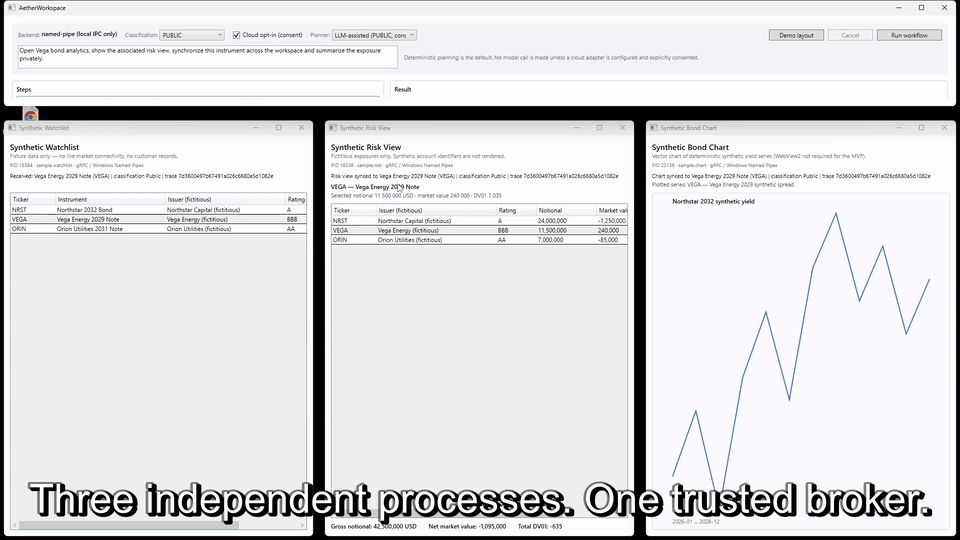

# AetherWorkspace

[](https://github.com/SergeyGer/AetherWorkspace/actions/workflows/ci.yml)
[](docs/testing/coverage.md)
[](https://github.com/SergeyGer/AetherWorkspace/actions/workflows/ci.yml)


[](LICENSE)

AetherWorkspace is an independent, vendor-neutral **reference implementation** of a
local-only desktop interoperability workspace. A policy-aware AI planner proposes a strict,
versioned `ActionPlan`; a deterministic executor validates and authorizes every step; and a
local broker drives independent synthetic desktop applications over authenticated local IPC.
All fixtures are fictitious — this is not production software, a compliance certification,
or a conformance claim.

**Start with the path that matches your goal.** Detailed status, evidence and technical
reference live in the **[Wiki](https://github.com/SergeyGer/AetherWorkspace/wiki)**.

## See it working

[](docs/assets/demo-hero.mp4)

Track B (primary, **narrated English video**): an LLM proposes a plan under explicit PUBLIC consent;
the policy-governed executor validates and runs it; typed context synchronizes three independent
Windows apps over authenticated local IPC. The deterministic Track A path remains available with
`usedModel=false`.
[Capture evidence](docs/testing/evidence/2026-11-18-v1.1-track-b-demo-gate.md) ·
[narrated-video evidence](docs/testing/evidence/2026-11-18-v1.1-narrated-demo.md).

## Start here

Choose the path that matches the time you have.

| I want to… | Time | What you get | Start |
|---|---|---|---|
| Understand the product | 5 min | Purpose, key concepts, safety boundaries | [Wiki: Home](https://github.com/SergeyGer/AetherWorkspace/wiki) |
| Run the Windows desktop app without building | 5 min | Unsigned portable WPF bundle + one-command launcher; verify checksums first | [Latest release](https://github.com/SergeyGer/AetherWorkspace/releases/latest) |
| Run the reference workflow | 10 min | Real trace, plan, denials and private summary | [Quick start](docs/quickstart.md) |
| See status, evidence and roadmap | 5 min | Milestones v0.1–v0.6, CI and desktop evidence | [Wiki: Project status](https://github.com/SergeyGer/AetherWorkspace/wiki/Project-Status) |
| Explore architecture and decisions | 20 min | Component map, invariants, ADRs | [Wiki: Architecture](https://github.com/SergeyGer/AetherWorkspace/wiki/Architecture) |
| Run the Windows 11 test strategy | 30 min | R1 lifecycle, deterministic counters, evidence rules | [Wiki: Testing strategy](https://github.com/SergeyGer/AetherWorkspace/wiki/Testing-Strategy-Windows11) |
| Extend contracts safely | 1 h | Contract studio, schemas, review/validate workflow | [Wiki: Development guide](https://github.com/SergeyGer/AetherWorkspace/wiki/Development-Guide) |
| Verify a release | 5 min | SHA-256 checksums + SPDX SBOM verification | [Reproducibility](docs/distribution/reproducibility.md) |
| Know limitations and residual risks | 3 min | Boundaries, safety notes, non-claims | [Wiki: Known limitations](https://github.com/SergeyGer/AetherWorkspace/wiki/Known-Limitations) |
| Read the end-to-end demo | 5 min | Narrated workflow with expected outputs | [Wiki: Narrated demo](https://github.com/SergeyGer/AetherWorkspace/wiki/Narrated-Demo) |

## What you get

- **Governed automation, not autonomous execution.** AI output is an untrusted proposal:
  strict plans, allowlisted actions, capability checks, bounded budgets and hash-chained,
  metadata-only audit before any side effect — no executable paths or arbitrary URLs.
- **Verifiable evidence.** Deterministic Linux/Windows CI, a headless reference workflow,
  Windows named-pipe and WPF UI lanes, plus a physical Windows 11 reference-desktop run
  recorded in the Wiki. If a claim is not backed by a test or measurement, it is not made.
- **A downloadable Windows desktop bundle.** Since v1.0.1 each release ships a Windows x64 ZIP
  with the WPF shell, three WPF sample apps, broker and a one-command launcher — no source
  checkout required (unsigned portable; verify the published SHA-256 and SBOM).
- **A runnable desktop reference.** Three independent synthetic apps (Watchlist, Risk,
  Chart), durable multi-monitor layouts, a Live Inspector with sanitized diagnostics export,
  and a review-only contract studio.

## Quick start

Requires the [.NET 10 SDK](https://dotnet.microsoft.com/download). Windows 11 is needed for
the WPF shell and window placement; Linux supports the headless host and the full portable
test suite.

```bash
./scripts/demo.sh      # build, run the reference workflow, witness the audit/egress proof
./scripts/verify.sh    # full deterministic verification suite
```

On Windows use `pwsh ./scripts/demo.ps1` to exercise the named-pipe transport. The demo starts
a broker, launches three independent synthetic apps, publishes a typed instrument context,
arranges their top-level windows, and produces a private local summary — with observable
denials, zero external calls for restricted data and a verified audit chain. Manual commands
and consent/denial experiments: [docs/quickstart.md](docs/quickstart.md).

## What this is — and is not

**Is:** an honest, testable reference for local-first multi-application automation with
explicit authorization, offline capability and end-to-end traceability. **Is not:** production
software, a compliance certification, perfect PII protection, or a claim that any third-party
runtime is supported. Synthetic data only; no credentials in the repository.

Security policy and vulnerability reporting: [SECURITY.md](SECURITY.md). Blueprint:
[spec v3.0 and release plan](docs/planning/).

## Documentation and development

- **Wiki (main reference):** [Home](https://github.com/SergeyGer/AetherWorkspace/wiki) ·
  [Project status](https://github.com/SergeyGer/AetherWorkspace/wiki/Project-Status) ·
  [Repository layout](https://github.com/SergeyGer/AetherWorkspace/wiki/Repository-Layout) ·
  [Known limitations](https://github.com/SergeyGer/AetherWorkspace/wiki/Known-Limitations)
- **Repository docs:** [quick start](docs/quickstart.md) · [architecture](docs/architecture/overview.md) ·
  [threat model](docs/security/threat-model.md) · [ADRs](docs/adr/) · [contracts](docs/contracts/) ·
  [benchmarks](docs/BENCHMARKS.md) · [releases](docs/releases/)
- **Contributing:** [CONTRIBUTING.md](CONTRIBUTING.md). Please keep the synthetic-data and
  fail-closed boundaries intact.

## License

MIT — see [LICENSE](LICENSE) and [THIRD_PARTY_NOTICES.md](THIRD_PARTY_NOTICES.md).
