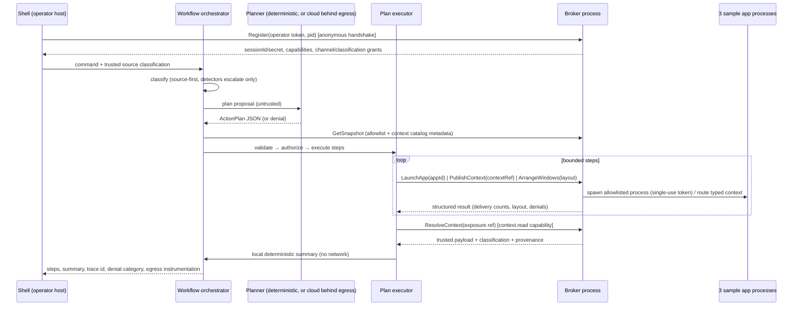

# Architecture overview (v0.1 vertical slice)

This page describes the **implemented** system, not the full v3.0 roadmap. It is
deliberately conservative: every component listed exists in `src/` and has committed
tests; deferred areas are stated as non-goals.

## 1. Component map and dependency direction

```
Aether.Contracts            (Protobuf wire + strict JSON models + error codes; no UI/AI)
   ▲   ▲   ▲   ▲   ▲
   │   │   │   │   └── Aether.Broker.Client  (typed gRPC client, session credentials)
   │   │   │   └────── Aether.AI            (planners, adapters, summarizers)
   │   │   └────────── Aether.Security      (classification, policy, egress, audit)
   │   └────────────── Aether.Execution     (plan parse/validate/authorize/execute)
   └────────────────── Aether.Broker        (local gRPC host: registry, launch, sessions,
                                             channels, windows, health, audit sink)
Aether.Workflow             (orchestration + typed action handlers; depends on all above)
Aether.Shell / .Headless    (operator hosts; compose workflow; no authoritative policy)
Aether.SampleApps(.Headless)(independent processes launched by the broker)
Aether.BrokerApp            (broker process entry point)
```

Dependency inversion is intentional: the broker has **no** dependency on AI or on the
executor. A failed/unavailable AI adapter cannot block deterministic IPC, and the
executor cannot launch arbitrary processes—it can only ask the broker to launch an
allowlisted app id.

### Windows vs cross-platform split

| Component | Target | Runtime status |
|---|---|---|
| Contracts, Security, Execution, AI, Broker.Client, Broker, Workflow, BrokerApp, Shell.Headless, SampleApps.Headless | `net10.0` | Built and executed on Linux (UDS) and buildable on Windows |
| Shell (WPF), SampleApps (WPF) | `net10.0-windows` | Compile-verified on Linux via `EnableWindowsTargeting`; runtime-verified by the Windows CI job |
| Transport | gRPC/HTTP2 over **named pipes** on Windows, **Unix domain sockets** on Unix | Same typed client/protocol; Linux path executed here, named-pipe path compile-verified + CI |

## 2. Reference workflow sequence



Every RPC carries the workflow `traceId`; context envelopes carry message/span ids and
provenance (source app instance, trace, timestamp). The operator host also verifies its
own hash-chained workflow audit after the run.

## 3. Deterministic execution lifecycle

```
INPUT → CLASSIFY → PLAN (untrusted) → STRICT JSON PARSE → SCHEMA/ALLOWLIST/ACTION-BUDGET VALIDATION
      → RESOLVE REGISTRY SNAPSHOT → CAPABILITY AUTHORIZATION → EXECUTE BOUNDED STEP → AUDIT OUTCOME
```

Per-step states are explicit: `Pending → Authorized → Running → Succeeded` or
`Denied`/`Failed`, plus `Compensated` for reversible launch steps. Invariants:

- Max actions is configurable (library default 5, hard cap 12); per-step and per-plan
  deadlines apply; recursion is impossible because plans are flat.
- Plan steps are typed (`LaunchApp`, `PublishContext`, `ArrangeWindows`,
  `SummarizeContext`, `ShowStatus`); fields that do not belong to the action are
  rejected. Unknown JSON members are rejected at parse time.
- The validator requires app ids from the trusted registry and context refs from the
  trusted catalog. Plans cannot carry executable paths, command lines, URLs or arbitrary
  payload content; path/URL/shell-like content is rejected.
- Denial never falls through to a higher-privilege alternative. `SummarizeContext` mode
  is constrained to `private` in v0.1, so untrusted plan text cannot select cloud
  processing.

## 4. Broker: trust, sessions, channels, windows

- **Registry/launcher:** apps are declared in a trusted local manifest. Executable and
  argument *templates* are expanded only with broker-supplied tokens, canonicalized,
  checked against configured executable roots, then spawned. The model can only name an
  app id.
- **Sessions:** launched apps receive a single-use, short-TTL registration token through
  the child environment. Registration binds the session to pid, process start time and
  canonical executable path, and issues a bounded session secret. Every privileged RPC
  re-checks a capability and resource grant; replay/expiry/spoofing are rejected.
- **Readiness:** `LaunchApp` waits until the app has subscribed to the context channel
  (or reported a window), removing the publish-before-subscribe race.
- **Channels:** one `default` app channel, bounded per-subscriber queues, FIFO per
  subscriber, at-most-once delivery, explicit overflow counts and a bounded dedupe buffer
  for client-supplied idempotency keys.
- **Windows:** only authenticated apps may report virtual/real top-level windows. The
  layout planner computes deterministic side-by-side rectangles within a configured work
  area; Windows uses `SetWindowPos` on reported handles (no reparenting), other platforms
  use the virtual arranger for deterministic CI assertions.
- **Health:** heartbeat state, missed-heartbeat unresponsive state, process-exit
  detection and bounded restart (`RestartApp`) without terminating broker/shell.
- **Audit:** metadata-only hash-chained events; optional JSONL persistence. No raw
  prompts, payloads, identifiers or secrets.

## 5. Security / AI boundaries

- Source-first classification (`PUBLIC`/`INTERNAL`/`RESTRICTED`/`UNKNOWN`); detectors may
  escalate but never downgrade; missing classification resolves to `UNKNOWN` (treated as
  restricted). Derived outputs inherit or increase sensitivity.
- Cloud is disabled by default and requires explicit consent; `RESTRICTED`/`UNKNOWN`
  never reach cloud providers; `INTERNAL` cloud is denied by default and only a
  policy-flagged sanitized flow (not implemented end-to-end) could change that.
- **One egress gateway** wraps every provider attempt. The gateway evaluates policy
  before invoking the transport, records metadata-only audit and exposes counters that
  tests use to prove zero external calls on denied paths.
- Reference planning is a deterministic grammar (no model). Optional cloud/local model
  adapters are provider-agnostic and disabled unless configured; model output is untrusted
  and always validated by the executor.

## 6. Configuration and artefacts

| Artefact | Location / configuration |
|---|---|
| App registry | `samples/registry/apps.json` (headless), `apps.windows.json` (WPF); trusted local file |
| Context catalog | `samples/contexts/contexts.json`; trusted classifications + synthetic payloads |
| Broker handshake file | written by broker `--endpoint-file`; contains transport, endpoint, operator token (current-user permissions on Unix, 0600) |
| Policy | built-in deny-by-default document; optional JSON via `--policy` (validated, fail-closed) |
| Audit | `--audit-file` JSONL for broker and shell; in-memory chain otherwise |
| Child diagnostics | `--child-log-dir` captures sample-app stdout/stderr lines for tests |
| Token expansion | `--token NAME=VALUE` for registry templates; never model-controlled |

## 7. Explicit non-goals for this baseline

Arbitrary third-party window embedding/docking; full FDC3 conformance (a declared subset
is documented); live market/production data; cloud-model training/enterprise identity;
autonomous code or command execution; no telemetry egress; model performance/cost claims.
See [`../limitations.md`](../limitations.md) and the ADRs for rationale.
