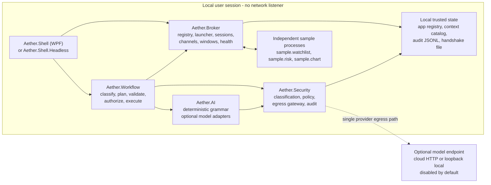
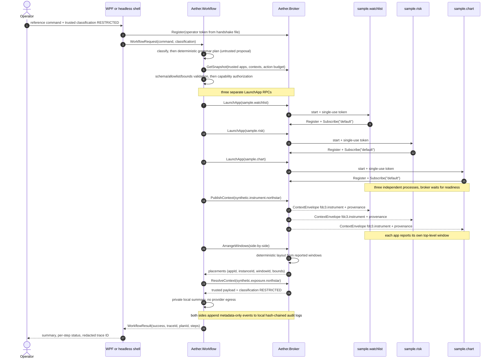
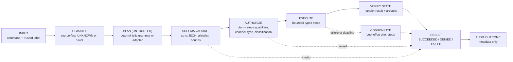

# Architecture overview

**Status:** current-state description, 2026-11-14 — not a target-state diagram. The
repository contains the M0 baseline, the v0.1 vertical slice and selected v0.2
reliability items; there is no release tag, and the full v0.2–v1.0 backlog is deferred
(see [implemented vs deferred](#implemented-vs-deferred)). Windows-specific paths (named
pipes, WPF shell/sample windows, Win32 placement) are **compile-verified only** in this
Linux workspace; Linux headless + Unix sockets are executed by tests/demo. Design
authority remains `_source/Technical_Specification.md` and
`_source/Implementation_Release_Plan.md`; implementation differences are recorded here.

## System context

All components run in one local user session. The broker has no network listener; the
only network egress is the optional, policy-gated model-provider path shown below.

The broker is the only component that owns the local IPC endpoint, child processes and
the broker audit file; sample apps own their windows and report handles to it. The shell
owns presentation and the operator session. `Aether.AI` proposes plans; it never launches
a process, opens a broker connection or mutates a file. `Aether.Execution` contains no IPC
or provider client; typed action handlers are injected by `Aether.Workflow`.

## Component responsibilities

| Component | Implemented responsibility | Deliberately outside its responsibility |
|---|---|---|
| `Aether.Contracts` | Protobuf `aether.v1` service/envelope, strict JSON models (`ActionPlan`, `AppManifest`, context catalog, window models), error codes, trace IDs, version constants | No UI, policy engine, provider or process code |
| `Aether.Security` | Source-first classification, fail-closed policy document/engine, consent state, single egress gateway, metadata-only hash-chained audit, environment secret lookup | No IPC, no plan execution, no provider-specific transport |
| `Aether.Execution` | Strict plan parser/validator, action allowlist and field checks, capability authorization, deterministic executor with deadlines, cancellation, per-step states and best-effort compensation | No model calls, no broker client, no executable paths |
| `Aether.AI` | Deterministic command grammar, optional cloud planning adapter, local deterministic summarization, optional loopback model summary, prompt construction | No IPC, no filesystem/process mutation, no direct provider call outside the egress gateway |
| `Aether.Broker` | Kestrel gRPC/HTTP2 endpoint (named pipe or Unix socket), allowlisted launcher, process-bound sessions, capability checks, bounded channels, window registry/arranger, health state, local audit | No prompt interpretation, no plan authorization, no network listener |
| `Aether.Broker.Client` | Typed `GrpcChannel` over the selected local transport, registration, heartbeat, streaming subscription, trace/session metadata | No policy or process launching |
| `Aether.Workflow` | End-to-end orchestration: classify, plan, validate, authorize, execute, summarize, audit; typed handlers that call the broker | No UI, no provider implementation, no policy definition |
| `Aether.Shell` / `Aether.Shell.Headless` | WPF command bar/status/cancel/trace view; headless CI host and structured result output | No authoritative policy logic; authorization stays in the executor/broker |
| `Aether.SampleApps` / `.Headless` | Three independent synthetic apps; register, subscribe, render typed context, report windows | No live market data, no third-party services |
| `Aether.BrokerApp` | Broker process host, CLI configuration, endpoint handshake file, SIGINT/SIGTERM shutdown | No UI or workflow logic |
| `tests/`, `benchmarks/` | Contract, security, execution, AI, broker, workflow, E2E and multi-process tests; BenchmarkDotNet and IPC latency harness | No production data or credentials |

## Dependency direction

Layering is enforced by `ProjectReference` entries in `src/*/*.csproj`; the graph is
acyclic and hosts are the only composition points.

- `Aether.Contracts` is the bottom layer and references no other project.
- `Aether.Security` depends only on `Contracts`. `Aether.AI`, `Aether.Execution` and
  `Aether.Broker` each depend on `Contracts` + `Security`.
- `Aether.Broker` does **not** reference `Execution` or `AI`: the broker executes
  authenticated RPCs, not plan semantics.
- `Aether.AI` does **not** reference `Broker.Client` or `Execution`: it has no IPC or
  side-effect surface.
- `Aether.Execution` does **not** reference `Broker.Client` or `AI`: handlers are
  injected by the workflow.
- `Aether.Workflow` composes `Contracts`, `Security`, `Execution`, `AI` and
  `Broker.Client`; `Aether.Shell`/`.Headless` compose `Workflow` plus the typed client.
- `Aether.BrokerApp` depends on `Broker`; sample apps depend only on
  `Broker.Client`, `Contracts` and `Security`.

## Reference workflow over local IPC

One reference command (`Open Northstar bond analytics, …`) exercises the complete
client/shell → broker → sample-app path. The shell registers once as the
non-launchable `aether.shell` operator app; the workflow reuses that session.

The E2E suite asserts that all three sample processes receive the same
`fdc3.instrument` context with the workflow `traceId`; delivery is at-most-once per
subscriber, FIFO per subscriber and bounded per channel with explicit overflow
accounting (`tests/Aether.E2E.Tests/MvpWorkflowE2ETests.cs`,
`src/Aether.Broker/Channels/ChannelRouter.cs`).

## Deterministic execution lifecycle

The plan is data, never a command stream. The pipeline below is implemented across
`Aether.Security`, `Aether.Execution`, `Aether.Workflow` and broker capability checks.

- Plan-level order is validate → authorize plan (`plan.execute`) → per-step authorize
  → execute → audit. The executor validates again even when the orchestrator already
  did, so a supplied plan file cannot bypass the first gate.
- Per-step states are `Pending → Authorized → Running → Succeeded | Denied | Failed`.
  A previously `Succeeded` step may later become `Compensated` when a later step fails
  and compensation is enabled.
- A denied plan or denied step never invokes a handler, and denial never falls through
  to a different or higher-privilege path. The unsafe-plan corpus asserts zero handler
  invocations for 100 documented negative plans
  (`tests/Aether.Execution.Tests/UnsafePlanCorpusTests.cs`).
- Defaults: step timeout 10 s, plan timeout 60 s, compensation timeout 2 s, at most 5
  actions per plan with a hard cap of 12. The reference configuration uses 6; see
  [ADR-008](../adr/ADR-008-reference-workflow-action-budget.md).
- Compensation is best effort: stopping a launched app is reversible; a published
  context is not, and window arrangement has no captured previous geometry, so those
  handlers report no compensation rather than pretending to undo them.

## Trust boundaries

| Boundary | Untrusted input / risk | Current control | Residual limitation |
|---|---|---|---|
| T1 UI and app content | Commands, plan files and app text may be adversarial | Only a typed command string reaches planning; app text is rendered, not interpreted; cloud responses are strict-parsed | Prompt injection can still influence a summary's wording |
| T2 AI plan | Model or file proposes actions, paths or URLs | Strict schema + allowlist + capability authorization + typed handlers; no executable path/URL/shell field exists | A structurally valid but undesirable plan is bounded, not semantically guaranteed |
| T3 provider egress | Cloud or local model calls could leak data | One `EgressGateway` before every transport; cloud disabled by default; RESTRICTED/UNKNOWN denied before the transport | Rule-based detection has false negatives; loopback models are not automatically air-gapped |
| T4 same-user IPC | Another same-user process could impersonate an app or operator | Single-use launcher token bound to pid/start-time/executable; session secret hash; per-RPC capability and resource checks; operator token file is current-user-only on Unix | Same-user OS isolation remains weak; operator token is reusable within a bounded budget |
| T5 local runtime | Broker, model runtime or local files could be tampered with | Allowlisted canonical paths, local-only endpoint, metadata-only audit chain, no telemetry | Local administrator can alter processes or truncate audit files |

The broker is not an OS security boundary stronger than the user account. Application
trust comes from the trusted manifest plus process binding and capability checks, not
from merely connecting to the local endpoint.

## Deployment modes

| Mode | Transport | UI and samples | Status in this checkout |
|---|---|---|---|
| Windows reference desktop | Windows named pipe (`named-pipe`) | WPF shell, WPF Watchlist/Risk/Chart, Win32 `SetWindowPos` arrangement | Windows code path is **compile-verified only** here; the Windows CI job is configured to build/test/run it |
| Windows headless demo | Windows named pipe | Headless shell + headless samples, virtual arranger | Configured in `scripts/demo.ps1`; not executed in this Linux workspace |
| Linux development / CI | Unix domain socket (`unix-domain-socket`) | Headless shell + headless samples, virtual arranger | Executed by `scripts/demo.sh`, `dotnet test` and the IPC benchmark |
| In-process integration tests | Unix domain socket bound by `BrokerHost` inside the test process | Fake/recording handlers or headless components | Executed by `tests/Aether.Broker.Tests` and related suites |

Platform selection is automatic: `BrokerEndpoint.DefaultTransport()` returns
`named-pipe` on Windows and `unix-domain-socket` elsewhere. The public API and protobuf
contract are identical across both transports; only `BrokerChannelFactory`'s
`ConnectCallback` and Kestrel's listener differ.

## Configuration and artefact layout

| Path / input | Role |
|---|---|
| `samples/registry/apps.json` | Trusted allowlist used by the Linux demo/E2E: three launchable samples + non-launchable `aether.shell`, capabilities, channels, context types, classifications |
| `samples/registry/apps.windows.json` | Same allowlist with the `{WPF_SAMPLES_EXE}` template for the WPF samples |
| `samples/contexts/contexts.json` | Trusted typed context catalog; plans reference `contextRef`, never payload JSON |
| `samples/fixtures/*.json` | Synthetic watchlist, risk and chart fixtures; marked `"synthetic": true` and covered by purity tests |
| `docs/contracts/*.schema.json`, `*.example.json` | JSON Schema projections and safe examples for plan, manifest, envelope and policy |
| Broker CLI (`--registry`, `--contexts`, `--endpoint-file`, `--audit-file`, `--max-actions`, `--transport`, `--allowed-root`, `--token`) | Local trusted configuration; templates are expanded only with broker-supplied tokens |
| Shell CLI (`--endpoint-file`, `--classification`, `--command` / `--plan-file`, `--planner`, `--cloud-enabled`, `--cloud-consent`, `--policy`, `--audit-file`, `--max-actions`) | Operator input and explicit cloud opt-in; no hidden network defaults |
| `.aether/demo/broker-endpoint.json` | Runtime handshake file containing endpoint, operator identity and short-lived token; written atomically, user-only on Unix |
| `.aether/demo/broker-audit.jsonl`, `shell-audit.jsonl`, `result.json`, `child-logs/` | Local runtime evidence from `scripts/demo.sh`; git-ignored |
| `BenchmarkDotNet.Artifacts/`, `.aether/benchmarks/` | Benchmark outputs; measured Linux IPC baseline is in `docs/BENCHMARKS.md` |

There are no installer, SBOM, signing, update-feed or release artefacts yet; those are
v1.0 scope. Configuration is command-line/file based; there is no hosted control plane.

## Implemented vs deferred

| Milestone | State | Evidence / remaining work |
|---|---|---|
| M0 feasibility and foundations | Implemented, except AW-004 docking spike (deferred, not evaluated) | Versioned protobuf/JSON contracts, local transport prototype, deny-by-default policy, threat model/ADRs, benchmark harness. Windows runtime evidence is CI-configured, not local |
| v0.1 vertical slice | Implemented | One automated three-process workflow, allowlisted launch/session handshake, typed context, guarded executor, private summary, denial paths, 100-plan negative corpus |
| v0.2 reliability and observability | **Partial** | Bounded queues/FIFO/overflow/dedupe, heartbeat + bounded restart + crash E2E, IPC latency baseline, hash-chained audit, offline/missing-model behaviour. Remaining: full fault-injection matrix, Windows reference benchmarks, WPF responsiveness/resource measurements, audit rotation, OS-level blocked-egress verification |
| v0.3 bounded FDC3 | **Partial / in progress** | [`docs/fdc3/supported-subset.md`](../fdc3/supported-subset.md) and the `fdc3.instrument` context on the single `default` channel with provenance. No intents, user/private channels, Desktop Agent API or external FDC3 interop (AW-023/AW-024 not started) |
| v0.4–v1.0 | Not started | NER/vault/model router/evaluation, multi-monitor layout persistence, Live Inspector, diagnostics export, contract studio, packaging/SBOM/release gate |

The issue-by-issue map is maintained in `docs/IMPLEMENTATION_STATUS.md`; measured
hardware/transport caveats are in `docs/limitations.md` and `docs/BENCHMARKS.md`.

## Explicit non-goals

- Embedding arbitrary third-party windows, guaranteed cross-process HWND hosting, `SetParent`/`HwndHost` docking or universal window reparenting; deferred and **not** evaluated (see [ADR-005](../adr/ADR-005-top-level-window-arrangement.md)).
- Full FDC3 3.0 conformance, intents/`raiseIntent`/`resolveIntent`, intent listeners, user/private channels, app channels beyond `default`, the Desktop Agent API, app-directory integration or external agent bridging.
- Live trading, order execution, production market connectivity or real customer data; every fixture here is synthetic and fictitious.
- Compliance certification, guaranteed PII detection, zero-leakage guarantees, or a claim that GDPR/DORA obligations are met by this reference implementation.
- Cloud model training/fine-tuning, an enterprise identity service, a hosted SaaS backend or a remote management plane.
- Autonomous code execution, or executing commands, URLs or executable paths produced directly by a language model.
- A network listener, telemetry upload, remote logging or a background update service.
- Deferred v0.2–v1.0 work: full fault injection, Windows reference benchmarks, durable multi-monitor layouts, Live Inspector, diagnostics export and contract generation.

## Related documents

- [FDC3 subset](../fdc3/supported-subset.md), [ADRs](../adr/ADR-001-dotnet10-windows-baseline.md), [implementation status](../IMPLEMENTATION_STATUS.md), [quick start](../quickstart.md)
- [Limitations](../limitations.md), [contracts](../contracts/), and the measured [benchmark baseline](../BENCHMARKS.md)
- Design baseline: `_source/Technical_Specification.md`, `_source/Implementation_Release_Plan.md`; planning copies under `docs/planning/`
