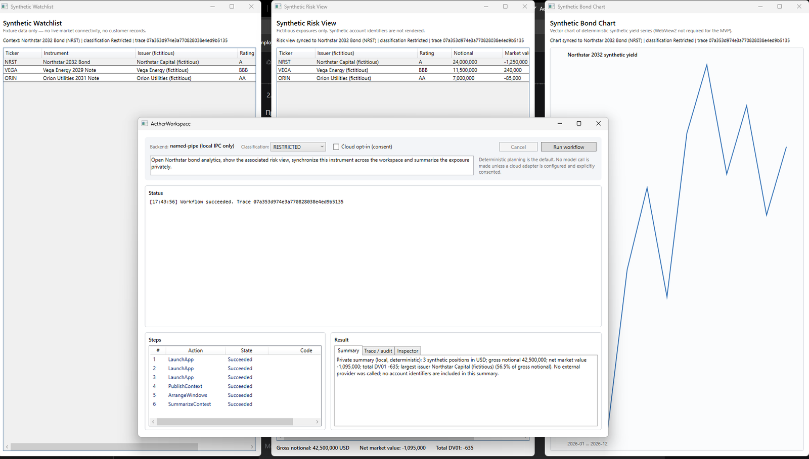

# v1.0.2 clean-machine Windows 11 desktop bundle verification (2026-11-16)

Operator-executed verification of the published **v1.0.2** Windows desktop bundle on the physical
Windows 11 reference laptop (synthetic data only; no real customer or personal data). Raw logs stay
local; the screenshot below contains only the synthetic sample windows and shell chrome.

## Release asset verification

| Field | Value |
|---|---|
| Tag | `v1.0.2` |
| Assets | `windows-x64-desktop.zip`, `headless-binaries.zip`, `source.zip`, `manifest.spdx.json`, `SHA256SUMS-v1.0.2.txt` |
| Integrity | **VERIFY PASS** — desktop/headless/source SHA-256 matched, SBOM `SPDX-2.2`, 64 packages |
| Bundle contents | `shell/Aether.Shell.exe`, `broker/Aether.BrokerApp.exe`, `samples/app/Aether.SampleApps.exe`, registry/contexts/fixtures, `Start-AetherWorkspace.ps1`, `Test-AetherWorkflow.ps1`, `Collect-Diagnostics.ps1`, `shell-headless/` (90 files) |

## Packaged headless workflow self-test

Executed from the extracted bundle: `pwsh .\desktop\Test-AetherWorkflow.ps1`

```
workflow shell exit: 0
status=succeeded trace=98730cf4b6948e9005f16834a17ad5d denial= steps=6
diagnostics bundle: ...\diagnostics\diagnostics-bundle-20261116-174241.json
broker audit: ...\logs\broker-audit.jsonl
```

## Packaged GUI desktop workflow

Executed with `Start-AetherWorkspace.ps1` → WPF Shell → pre-filled reference command:

- Shell status: **“Workflow succeeded.”** trace `07a353d9e3a770828036e4ed9b5135`
- Steps list: 3× `LaunchApp`, `PublishContext`, `ArrangeWindows`, `SummarizeContext` — **all Succeeded**
- The three real WPF sample windows remained open: Synthetic Watchlist, Synthetic Risk View,
  Synthetic Bond Chart; typed context visible in each window; private local summary and the
  **Inspector** tab available.
- No cloud opt-in, no external provider call; all displayed values are synthetic.



## Notes

- An earlier v1.0.1 clean-machine observation reported the sample windows closing immediately; it
  did not reproduce on v1.0.2 (with the same workflow and packaged layout). v1.0.2 retains the WPF
  sample heartbeat/diagnostics and packaged self-test/diagnostics collector so any recurrence is
  directly inspectable. No product code fix is claimed for that earlier transient observation.
- This confirms the remaining G-01/G-11 acceptance points (desktop executable delivered and runs
  the reference workflow without a source checkout/build) for the tested Windows 11 configuration.
